# ケーススタディ下書き：ゴミ出し忘れ防止アプリ

> 【要記入】は、制作が進んでから埋める箇所です。
> 公開前に「個人情報の扱い」の注意（末尾）を確認してください。

---

## 1. 概要

**ごみ日和**
実家を出て初めてゴミ出しをする人が、覚えようと頑張らなくてもゴミをためずに暮らせるWebアプリ。

- **役割**：リサーチ、課題定義、UX設計、UIデザイン、プロトタイプ作成、実装【実装する場合】
- **期間**：2026年10月〜【要記入】
- **ツール**：Figma、Cursor（リサーチの整理とAIによる模擬インタビューに使用）
- **対象地域**：デザインでは架空の市「桜市」を使用。実装時は実在する市の公開データを使う予定
- **プラットフォーム**：Webアプリ（ホーム画面ウィジェットはFigmaでデザインのみ）

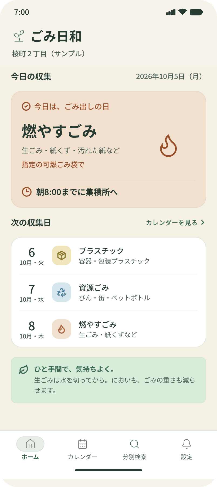

> 画像の置き場所：`public/works/gomi-biyori/`  
> まだファイルがない場合は、下の「画像の入れ方」を見てから書き出してください。

---

## 2. 背景

半年前、私は実家を出て集合住宅で一人暮らしを始めました。実家ではゴミ出しをしたことがなく、燃えるゴミの日はなんとか覚えたものの、それ以外の収集日はまったく覚えられませんでした。出し忘れたゴミは、部屋のゴミ箱にたまっていきました。

調べてみると、引っ越し経験者の58.3%が引っ越し先のローカルルールに驚いた経験があり、そのうち49.5%が「ごみの出し方」を理由に挙げていました（株式会社トナリスク調査、2023年、551名）。自分だけの問題ではないと考え、このテーマを選びました。

---

## 3. リサーチ

人を集めてインタビューをすることが難しかったため、次の4つの方法を組み合わせました。

| 方法 | 内容 | 位置づけ |
|---|---|---|
| 競合調査 | 自治体アプリ、自治体のLINE、5374.jp、カレンダーアプリの4つを比較 | 公開情報 |
| レビュー分析 | ゴミ分別アプリ3つのレビュー27件を分類 | 実際の利用者の声 |
| 当事者としての振り返り | 自分自身の経験をインタビュー形式で振り返り | 実体験（1名） |
| AIによる模擬インタビュー | AIが演じる架空の人物に2回インタビュー | 質問設計の練習と仮説出し（ユーザーの声としては扱わない） |

### 競合調査で分かったこと

既存のサービスは「住む地域が決まった人に収集日を知らせる」ことはできています。一方で、地域選択や通知設定などの初期設定を自分で行う必要があり、建物ごとのルール（集積所の場所や、前の夜から出せるかどうか）は扱っていませんでした。

### レビュー分析で分かったこと

| 不満のテーマ | 件数 | 実際の声（抜粋） |
|---|---|---|
| 肝心な時に開けない | 8件 | 「ゴミ出しの日の朝にアプリを開こうとすると…ゴミ出しに間に合わない」 |
| 情報が古い・間違っている | 3件 | 「アプリに書いてある通りに出したのに回収されなかった」 |
| 通知のタイミングや対象が合わない | 3件 | 「月に1回とかの…準備が必要なゴミ出し通知としては遅すぎて」 |
| 分別が分かっても、出し方が分からない | 2件 | 「引っ越して来たばかりで…結局出し方についてまたネットで調べなきゃならない」 |

27件と小さなサンプルのため、傾向をつかむための調査として扱いました。

### 当事者としての振り返りで分かったこと

| 事実 | 分かったこと |
|---|---|
| 燃えるゴミを忘れるのは、朝急いでいた時 | 朝は思い出す余裕がない。建物のルールで前の夜から出せるので、前の夜に思い出させる方が効く |
| 冷蔵庫に貼った市の紙は、実際はあまり見ない | 正確な情報でも、自分から見に行く仕組みでは届かない |
| 週2回の燃えるゴミ以外は覚えられない | 月1回のゴミを1回逃すと、次は1か月後になる。回数が少ないほど影響が大きい |
| ゴミアプリの存在を知らなかった | 見つけてもらう入口と、始めるまでの手間も設計の対象になる |
| 出し忘れたら「また忘れた」と思って放置 | 忘れた後に立て直す手段がなく、あきらめにつながっている |

### AIによる模擬インタビューで出てきた仮説

AIが演じる架空の人物（ゴミ出しに慣れた大学2年生）へのインタビューで、「ゴミの日を書いたメモを待ち受け画面にしている」という工夫が出てきました。ここから「通知よりも、開かなくても目に入る場所に置く方が効くのではないか」という仮説を立てました。架空の回答のため、仮説としてのみ扱い、【ユーザビリティテストで確かめた結果を記入】。

---

## 4. 課題の定義

### ペルソナ

**ひなた（20代・社会人・一人暮らし半年）**
実家を出て集合住宅に住み始めた。実家ではゴミ出しをしたことがない。収集日は市の紙を冷蔵庫に貼って管理しているが、ほとんど見ていない。
ゴール：覚えようと頑張らなくても、ゴミをためずに暮らしたい。

### 課題文

> 実家を出て初めてゴミ出しをする人は、朝の忙しさの中で収集日を思い出せない。特に月1〜2回のゴミは覚える手がかりがなく、出し忘れが続いてゴミが部屋にたまり、あきらめてしまう。

### デザインの問い（How Might We）

- どうすれば、前の夜のいつもの行動の中で、ゴミ出しを思い出せるか？
- どうすれば、回数の少ないゴミを「覚えなくても」出せるようになるか？
- どうすれば、出し忘れた後に「次こそ出せる」と思えるか？

---

## 5. デザインの原則

リサーチから、画面を作るときの判断基準を5つ定めました。

1. **見に行かせず、目に入れる**：開かなくても、普段見る場所に必要な情報がある
2. **計算させない**：「第2水曜」ではなく「今日・明日」や具体的な日付で伝える
3. **建物のルールに合わせる**：前の夜に出せるなら、前の夜に知らせる
4. **出し方まで一度に**：何ゴミかだけでなく、どう出すかも同時に分かる
5. **忘れても責めない**：次の収集日を示して、あきらめを防ぐ

---

## 6. 設計

### 利用シーンとユーザーフロー

【任意：ユーザーフロー図 `flow.png` を同じフォルダに入れるとここに表示されます】

1. **はじめて使う**：アカウント登録なし。地区を選ぶ → 建物のルールを選ぶ、の2ステップで始められる。通知の許可は初回設定では求めず、ホームで案内する
2. **いつもの前夜／当日朝**：ホームで「何を、いつまでに」が一目で分かる。通知をオンにしている場合は、文面だけで用が済む
3. **収集後（出し忘れた翌朝を含む）**：責める言葉を使わず、「次の収集日」と保管のコツを伝える
4. **捨て方が分からない物**：分別検索で品目名を入れ、種類・出し方・次に出せる日を一度に確認する

### 通知のルール

ゴミの収集回数に合わせて、通知のタイミングを変えました。

| ゴミの種類 | 通知するタイミング |
|---|---|
| 毎週（燃やすごみ） | 前の夜、または当日の朝（建物のルールによる） |
| 月1〜2回（缶・びん・ペットボトル、紙類など） | 3日前の予告＋前の夜 |
| 2か月に1回（蛍光灯・乾電池・ライター） | 1週間前の予告＋前の夜 |

### 作らないと決めたこと

- **「出した」ボタン**：毎回押す手間が、ユーザーの「考えることが多すぎる」という負担を増やすため。収集日が過ぎたら、出したかどうかに関係なく次の収集日を表示する
- **アカウント登録**：初期設定でつまずくと、その日のうちに使うのをやめてしまうため
- **ホーム画面ウィジェット（実装）**：Webアプリでは作れないため、Figmaでデザインのみ作成し、Web版はホーム画面への追加と通知、アイコンのバッジで代用する

### 色だけで情報を伝えない

ゴミの種類は色で見分けやすくしつつ、必ずアイコンと文字を組み合わせました。色の見え方は人によって異なること、またiPhoneのロック画面ウィジェットなど単色で表示される場面があることが理由です。

---

## 7. デザイン

### ワイヤーフレームからUIへ変えた点

最初の案にはログイン画面があり、初回設定のあとに通知の許可を求めていました。リサーチでは「最初の設定でつまずくと、その日のうちにやめてしまう」ことが分かっていたため、次のように変えました。

| 変える前 | 変えた後 | 理由 |
|---|---|---|
| ログイン画面がある | なくし、地区選択から始める | アカウント登録を求めない方針と一致させる |
| 初回設定が3ステップ以上 | 地区 → 建物のルール、の2ステップ | 始めるまでの手間を最小にする |
| 初回で通知の許可を求める | ホームに案内カードを置く | 先に価値（自分の地区の収集日）を見せてから、通知を提案する |
| 建物のルールと通知時刻が別画面 | ルールを選ぶと、通知時刻がその場で決まる | 「この質問に答えると何が決まるか」がその場で分かるようにする |
| タブ名が「通知設定」 | 「設定」 | 地区・建物・通知の3つを扱うため |

【任意：ワイヤーと完成の比較 `wire-vs-ui.png` を同じフォルダに入れるとここに表示されます】

### 画面の構成

よく使う画面は、画面下の4つのタブ（ホーム、カレンダー、分別検索、設定）から1回のタップで開けるようにしました。

| 画面 | 役割 | 対応する原則 |
|---|---|---|
| はじめての設定（1/2） | 町名・郵便番号で地区を検索し、候補から選ぶ。戻るボタンとタブバーは出さない | 最初の設定でつまずかせない |
| はじめての設定（2/2） | 「前の夜から出せる／当日の朝だけ／わからない」を選び、通知時刻をその場で確認・変更する | 建物のルールに合わせる |
| ホーム（当日朝） | 「今日の収集」を大きなカードで表示し、出す期限（朝8時まで）を添える。その下に、次の収集日を日付と曜日で3件表示 | 計算させない |
| ホーム（収集後） | 「今朝の収集は終わりました」と伝え、次の収集日と保管のコツを表示。責める言葉は使わない。通知がオフのときは、ホーム下部に案内カードを出す | 忘れても責めない／見に行かせず、目に入れる |
| 収集カレンダー | 1か月分の収集日を、色・略字・凡例で表示。日付を選ぶと、その日の出し方が分かる | 計算させない／色だけで情報を伝えない |
| 分別検索 | 品目名から、種類・次に出せる日・出す前の3ステップを一度に表示。出典と更新日をつける | 出し方まで一度に |
| 設定 | 地区の変更、建物のルール、通知のオン・オフと時刻、ゴミの種類ごとの通知。建物が「朝だけ」のときは前日通知を「なし」にする | 建物のルールに合わせる |
| ホーム画面ウィジェット（Figmaのみ） | 小：今日だけ／中：今日と明日。アプリを開かなくても分かる | 見に行かせず、目に入れる |

| 画面 | 画像 |
|---|---|
| はじめての設定（1/2） | 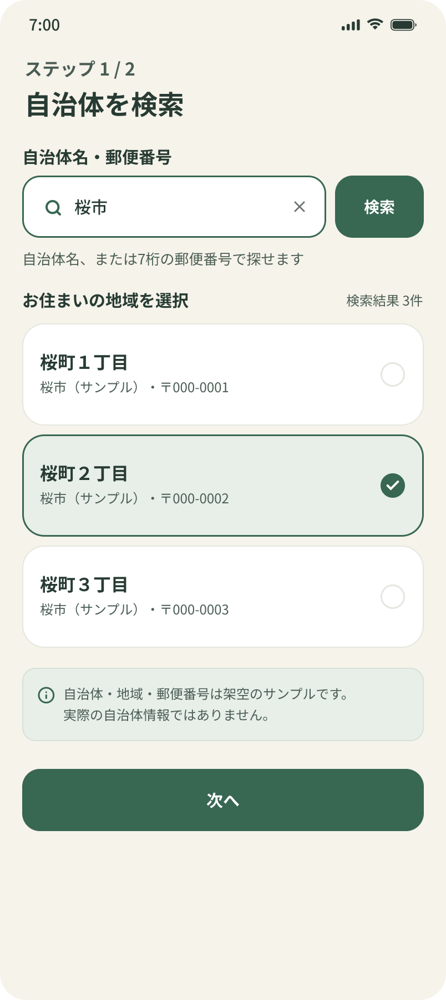 |
| はじめての設定（2/2） | 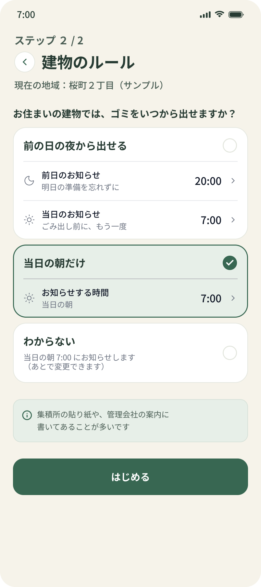 |
| ホーム（当日朝） |  |
| ホーム（収集後） | 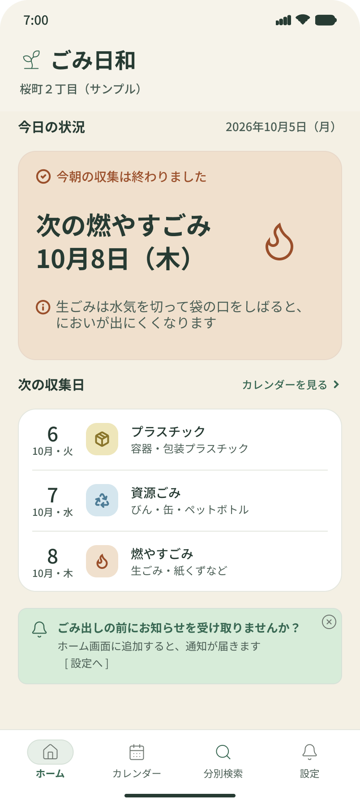 |
| 収集カレンダー | 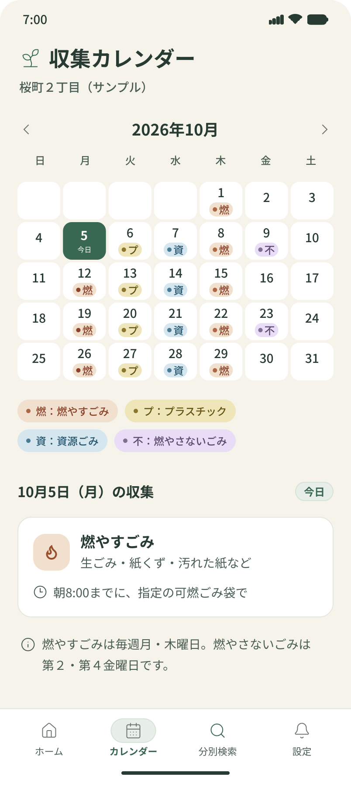 |
| 分別検索 | 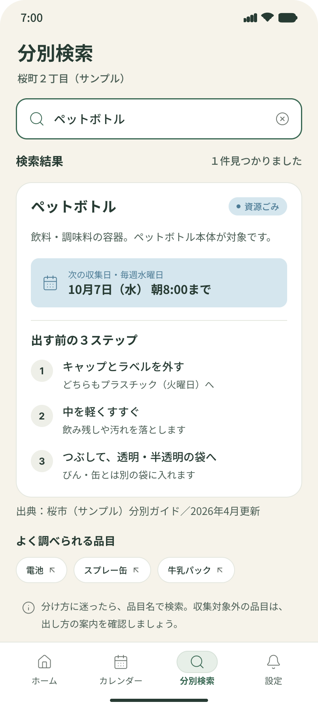 |
| 設定 | 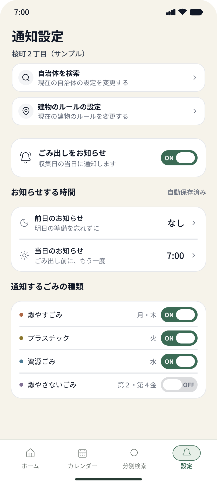 |
| 設定 → 地区の変更 | 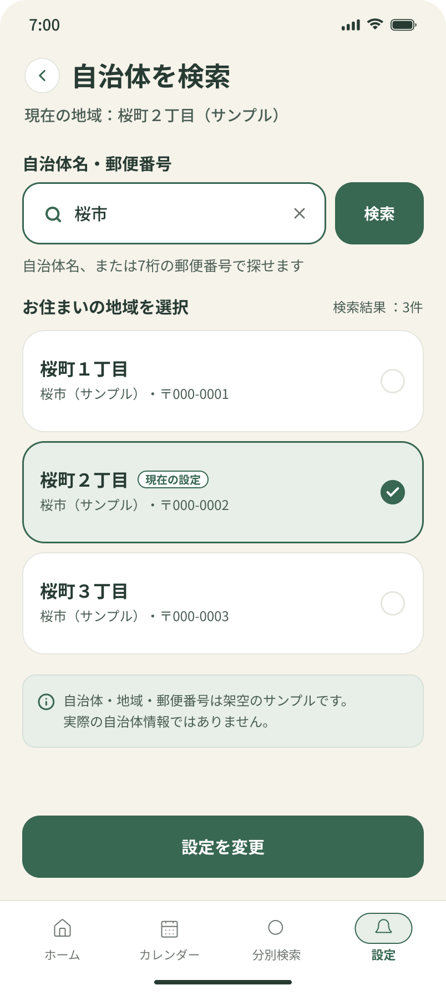 |
| 設定 → 建物のルール | 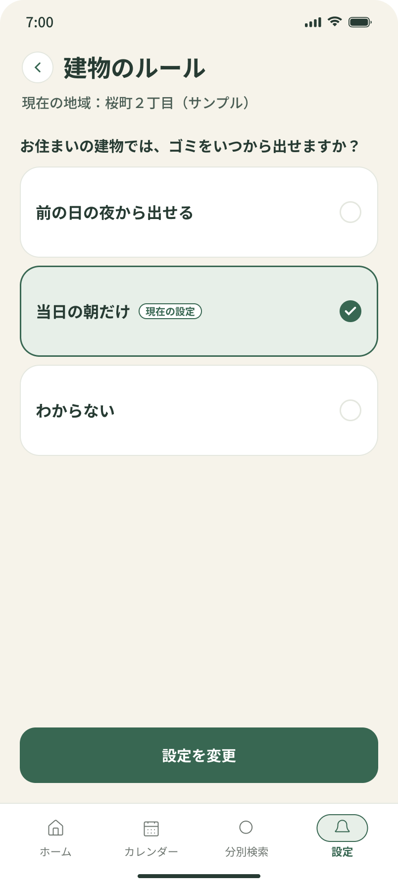 |
| ウィジェット（小） | 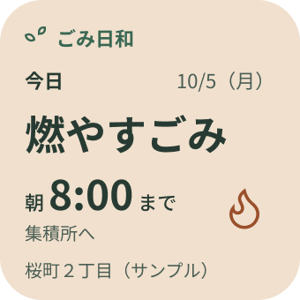 |
| ウィジェット（中） | 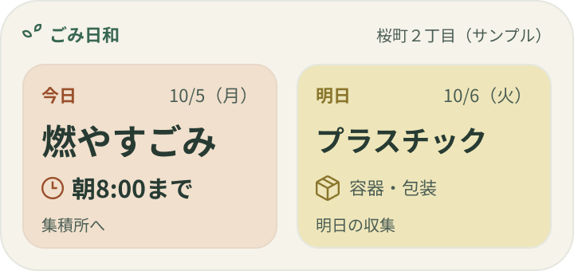 |

### デザインで工夫した点

- **色・アイコン・文字の3つで種類を伝える**：燃やすごみは炎のアイコンと暖色、というように、色が分からなくてもアイコンと文字で見分けられるようにした。カレンダーでは「●燃」のように略字も添えた
- **「いつまでに」を一緒に見せる**：当日朝のホームでは、ゴミの種類だけでなく「朝8:00までに集積所へ」をカードの中に入れた
- **収集後は「次の日付」を主役にする**：収集時間を過ぎたら、「次の燃やすごみ／10月8日（木）／3日後」を大きく見せ、保管のコツを1行添えた。「出し忘れていませんか？」などの言葉は使わない
- **建物のルールが通知とホームの両方を変える**：「前の夜から出せる」なら前日通知を出し、「当日の朝だけ」なら前日通知を「なし」にする。設定の説明文も、実際の通知内容に合わせて切り替える
- **通知の案内はホームで行う**：初回設定では求めず、「ごみ出しの前にお知らせを受け取りませんか？／ホーム画面に追加すると、通知が届きます」と案内する
- **架空の市「桜市」を使った**：デザイン段階では実在の住所が推測されないようにした。実装時は実在する市の公開データを使う
- **【配色の意図を自分の言葉で記入】**：例「毎日目に入るものなので、警告のような強い色を避け、ベージュの背景と深い緑で落ち着いた印象にした」

### プロトタイプ

【Figmaのプロトタイプのリンク】
【操作している様子の動画】

---

## 8. 検証

【ユーザビリティテストの結果を記入】

記入の例：
- 誰に（何人に）テストしたか
- どんなタスクをお願いしたか（例：「初期設定をして、次に出すゴミを確認してください」）
- どこで迷ったか、何を言っていたか
- それを受けて何を直したか（修正前と修正後の画像）

---

## 9. 学びと次の課題

【制作を終えてから記入】

書く内容の例：
- 人を集めにくい状況で、レビュー分析と当事者としての振り返りを組み合わせたこと
- 模擬インタビューで、深掘りの質問の大切さを学んだこと
- ウィジェットという理想の形と、Webで作れる範囲の折り合いをどうつけたか
- 次にやりたいこと（加古川市以外への対応、実在のユーザーへのインタビューなど）

---

## 公開前の注意：個人情報の扱い

- 「明石市から加古川市へ転居」のように、住んでいる市が分かる表現は避けています。デザインでは架空の市「桜市」を使い、居住地の推測を防いでいます。実装で実在の市名を出す場合は、公開前にどこまで書くか決めてください。
- 町名、地区番号、建物名など、住所が特定できる情報は載せないでください。
- 架空の人物（AIによる模擬インタビュー）の発言を、実在ユーザーの声として引用しないでください。

---

## 出典

- 株式会社トナリスク「引っ越し先で驚いたローカルルール」調査（2023年2〜3月、引っ越し経験者551名）
- 加古川市「ごみの収集日程表」 https://www.city.kakogawa.lg.jp/kurashi/kankyo_eisei/gomi/gominodashikata_shushu/1413372203696.html
- App Store「ごみ分別アプリ さんあ〜る」「川崎市ごみ分別アプリ」「横浜市ごみ分別アプリ」、Google Play「さんあ〜る」の公開レビュー（2026年10月閲覧）

---

## 付録：画像の入れ方

### 1. Figmaで書き出す

1. 書き出したい画面のフレームを1つクリックします（Shiftを押しながら複数選んでもOK）。
2. 右側のパネルを一番下までスクロールし、「Export」を探します。
3. 「＋」を押し、倍率を **2x**、形式を **PNG** にします。
4. 「Export ○ layers」を押します。ダウンロードフォルダに保存されます。

### 2. ファイル名を変える

Finderで、書き出した画像の名前を次の表どおりに変えます（名前がずれると、下書きに表示されません）。

| ファイル名 | どの画面か |
|---|---|
| `hero-home.png` | ホーム（当日朝）をiPhone枠に入れたもの。なければ `home-morning.png` と同じ画像でも可 |
| `home-morning.png` | ホーム（当日朝） |
| `home-after.png` | ホーム（収集後） |
| `onboarding-1.png` | はじめての設定 1/2 |
| `onboarding-2.png` | はじめての設定 2/2 |
| `calendar.png` | 収集カレンダー |
| `search.png` | 分別検索 |
| `settings.png` | 設定 |
| `settings-area.png` | 設定 → 地区の変更 |
| `settings-rules.png` | 設定 → 建物のルール |
| `widget-s.png` | ウィジェット小 |
| `widget-m.png` | ウィジェット中 |
| `wire-vs-ui.png` | （任意）ワイヤーと完成を並べたもの |
| `flow.png` | （任意）ユーザーフロー図 |

### 3. フォルダに入れる

名前を変えた画像を、次のフォルダにドラッグ＆ドロップします。

```text
namba-portfolio/public/works/gomi-biyori/
```

Cursorの左側のファイル一覧で `public` → `works` → `gomi-biyori` を開き、そこに落とす方法でも大丈夫です。

### 4. 表示を確認する

1. Cursorで `docs/case-study-gomi-app.md` を開きます。
2. 右上あたりのプレビュー（虫めがねや分割表示のアイコン）で、Markdownプレビューを開きます。
3. 画像が表示されればOKです。壊れたアイコンのままなら、ファイル名のスペルを表と見比べてください。

### hero-home（概要の一番上）について

iPhoneの枠に入れた画像がまだない場合は、次のどちらかで大丈夫です。

- FigmaのCommunityで「iPhone mockup」を探し、ホーム画面のフレームを枠の中に入れる
- いったん `home-morning.png` をコピーして、名前を `hero-home.png` にする（あとで枠入りに差し替え可能）
